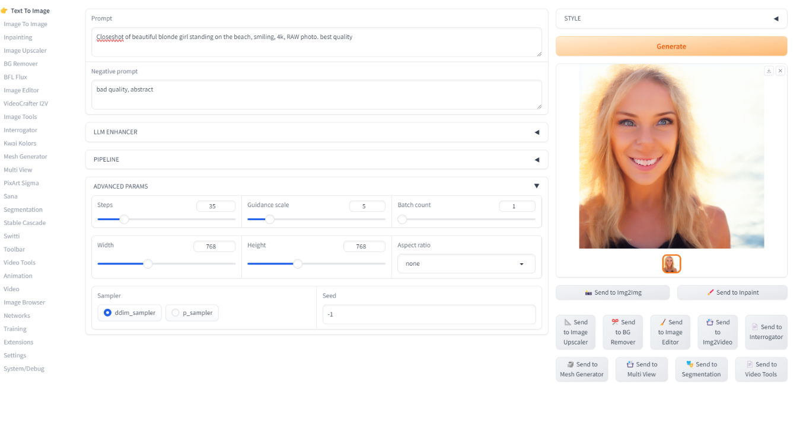
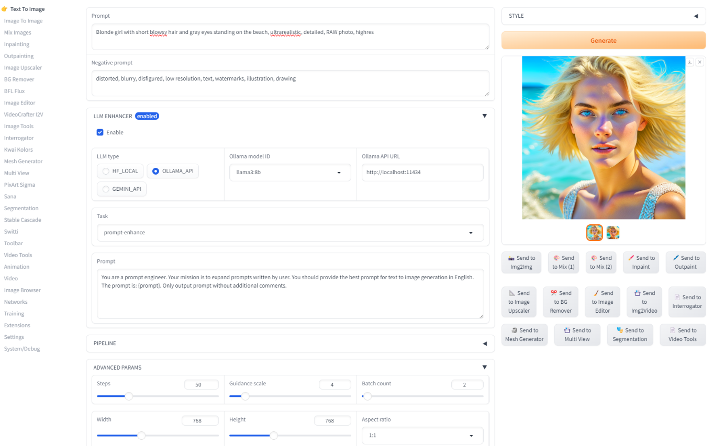
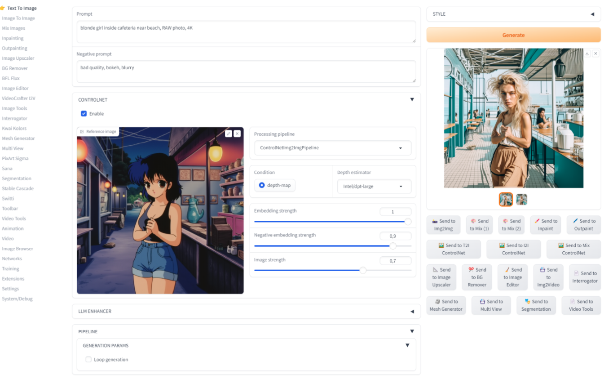
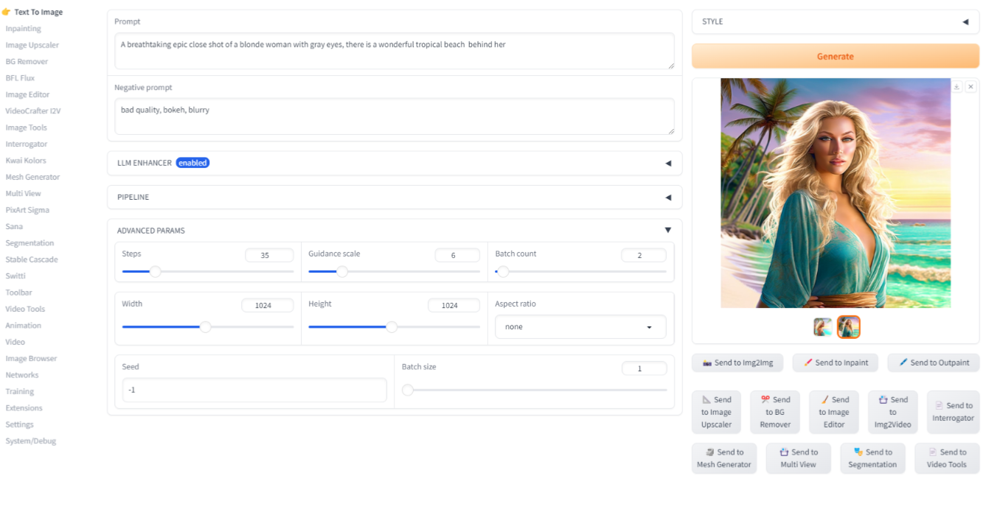
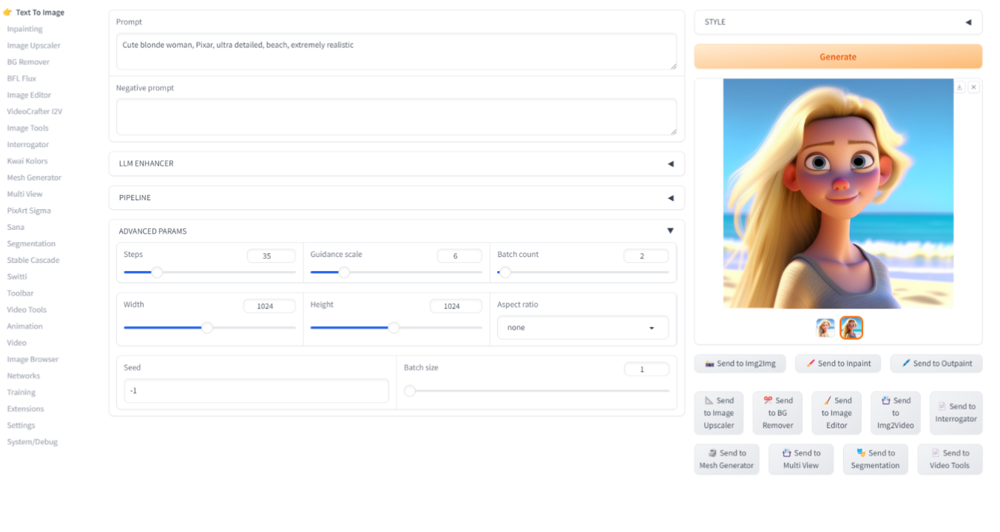

# Kubin

## Disclaimer

After 2.5 years, Kandinsky models are finally [entering](https://github.com/comfyanonymous/ComfyUI/pull/10988) the mainstream generative AI ecosystem and starting to get the recognition they deserve. At this point, this project, its GUI and its overall approach to building ML tools, feels outdated and no longer reflects how this kind of software is typically built today. I may still push occasional updates, but no major development is planned here. The Kandinsky models themselves will for sure continue to appear in some of my other upcoming projects.

## Description

Web-GUI for Kandinsky generative AI models ([Kandinsky2](https://github.com/ai-forever/Kandinsky-2/), [Kandinsky3](https://github.com/ai-forever/Kandinsky-3), [Kandinsky4](https://github.com/ai-forever/Kandinsky-4), [Kandinsky5](https://github.com/ai-forever/Kandinsky-5)).  

## Features

| Model                                                                                        | 2.0 | 2.1 | 2.2 |3.0  |3.1  |4.0  |5.0  |
| -------------------------------------------------------------------------------------------- | --- | --- | --- | --- | --- | --- |--- |
| Txt2img                                                                                      | ✔   | ✔  |  ✔  | ✔  | ✔  |  ✔  |     |
| Img2img                                                                                      | ✔   | ✔  |  ✔  | ✔  | 🕒 |      |     |
| Txt2Video                                                                                    |     |     |      |    |    | ✔    | ✔   |
| Img2Video                                                                                    |     |     |      |    |    | 🕒   |     |
| Video2Audio                                                                                  |     |     |      |    |    | ✔   |     |
| Mixing                                                                                       |     | ✔  |  ✔  | 🕒 | 🕒 |       |     |
| Inpainting                                                                                   | ✔   | ✔  |  ✔  | ✔  | ✔  |      |     |
| Outpainting                                                                                  |     | ✔  |  ✔  | 🕒 | 🕒  |      |     |
| ControlNet                                                                                   |     |     |  ✔  |    | 🕒  |      |     |
| IpAdapter                                                                                    |     |     |      |    | 🕒 |      |     |
| Diffusers pipeline                                                                           |     | ✔  |  ✔  |  ✔ | 🕒  |      |     |
| Low-VRAM options                                                                             |     |     |  ✔  |  ✔ | ✔  |  ✔  |  ✔  |
| ext. [Image browser](https://github.com/seruva19/kubin-extensions#kd-image-browser)          | ✔   | ✔  |  ✔  |  ✔ | ✔  |  ✔   |  ✔  |
| ext. [Image editor](https://github.com/seruva19/kubin-extensions#kd-image-editor)            | ✔   | ✔  |  ✔  |  ✔ | ✔  |  ✔   |     |
| ext. [Fine-tuning](https://github.com/seruva19/kubin-extensions#kd-training)                 |     | ✔  |  🕒 |     |    |      |     |
| ext. [LoRA training and inference](https://github.com/seruva19/kubin-extensions#kd-training) |     |     |  ✔  |     |    |    |  🕒  | 
| ext. [Style library](https://github.com/seruva19/kubin-extensions#kd-prompt-styles)          | ✔   | ✔  |  ✔  |  ✔ | ✔  |  ✔   |     |
| ext. [Image upscaling](https://github.com/seruva19/kubin-extensions#kd-upscaler)             | ✔   | ✔  |  ✔  |  ✔ | ✔  |  ✔   |     |
| ext. Video upscaling                                                                         |     |     |     |     |    |  🕒  | 🕒   |
| ext. [Img2mesh](https://github.com/seruva19/kubin-extensions#kd-mesh-gen)                    | ✔   | ✔  |  ✔  |  ✔ | ✔  |  ✔   |     |
| ext. [Image interrogation](https://github.com/seruva19/kubin-extensions#kd-interrogator)     | ✔   | ✔  |  ✔  |  ✔ | ✔  |   ✔  |     |
| ext. [Video interrogation](https://github.com/seruva19/kubin-extensions#kd-video-tools)      | ✔   | ✔  |  ✔  |  ✔ | ✔  |   ✔  |     |
| ext. [Segmentation](https://github.com/seruva19/kubin-extensions#kd-segmentation)            | ✔   | ✔  |  ✔  |  ✔ | ✔  |   ✔  |     |
| ext. [Deforum](https://github.com/seruva19/kubin-extensions#kd-animation)                    |     | 🕒  |  ✔  |    |    |      |     |
| ext. [Animation](https://github.com/seruva19/kubin-extensions#kd-video)                      |     |     |     |  ✔ |  ✔ |      |
| ext. [Background remover](https://github.com/seruva19/kubin-extensions#kd-bg-remover)        | ✔   | ✔  |  ✔  |  ✔ | ✔  |      |     |
| ext. [LLM prompt enhancer](https://github.com/seruva19/kubin-extensions#kd-llm-enhancer)     | ✔   | ✔  |  ✔  |  ✔ | ✔  |  ✔   |   ✔  | ✔
| Dynamic prompts                                                                              | ✔   | ✔   | ✔  |  ✔ |  ✔ |  ✔  |     |   
| Prompt weighting                                                                             |     |     | 🕒  |    |     |      |     |
| ext. Area composition                                                                        |     |     | 🕒  |    |     |      |     |

## Screenshots

Toggle

### Kandinsky 2.0

### Kandinsky 2.1

### Kandinsky 2.2

### Kandinsky 3.0

### Kandinsky 3.1

### Kandinsky 4.0

### Kandinsky 5.0

## Google Colab

 

## Documentation

Some bits of information can be found [here](https://github.com/seruva19/kubin/blob/main/DOCS.md).

